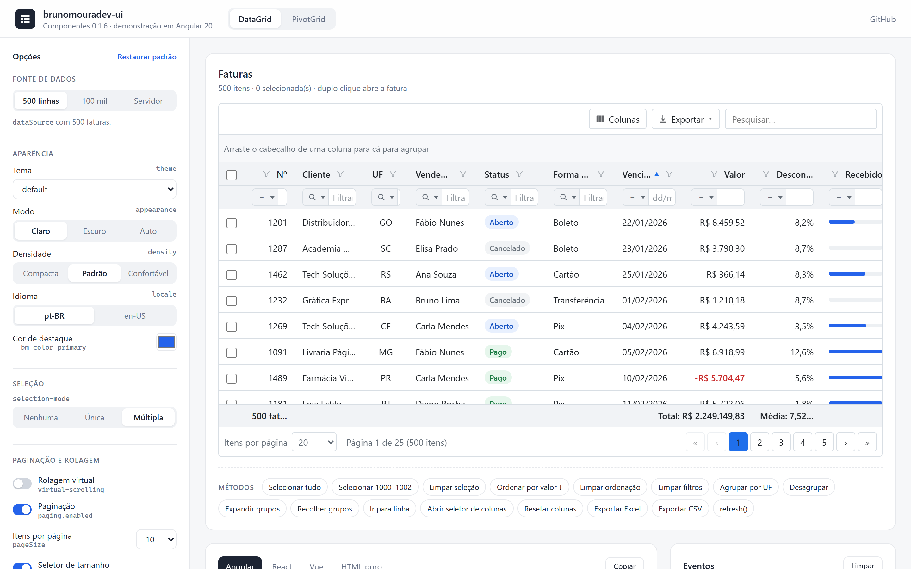
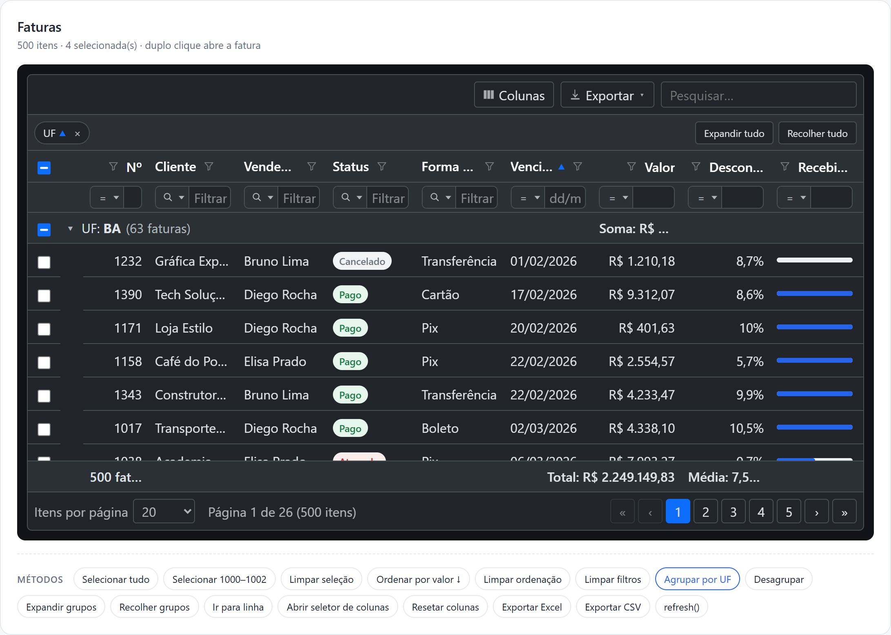
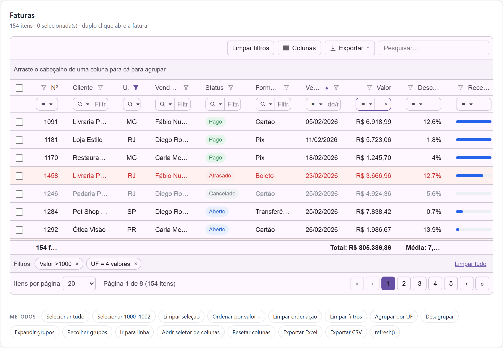
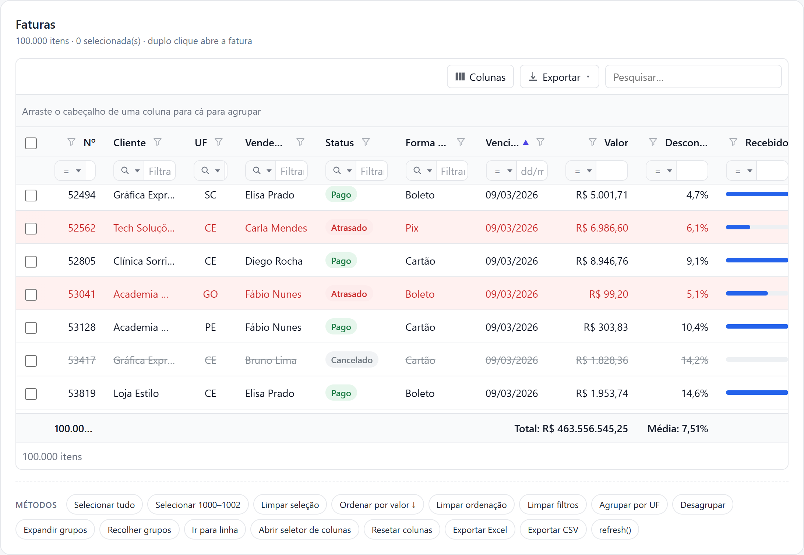
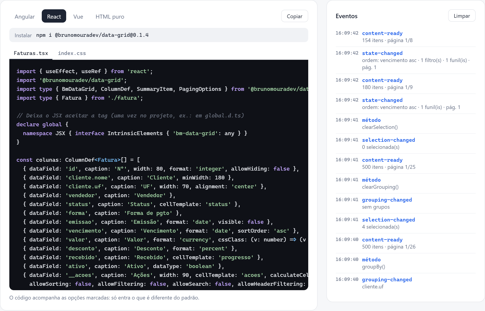

# brunomouradev-ui

Biblioteca de componentes em **Web Components** (Lit + TypeScript), no estilo DevExpress. Os componentes não dependem de framework e rodam em Angular (11+), React, Vue ou HTML puro.

O visual se adapta ao projeto: `configure({ theme: 'bootstrap4' | 'bootstrap5' | 'tailwind' | 'material' })`, com claro/escuro, densidade e variáveis CSS para customizar.

## Links

- **Este projeto (código-fonte):** https://github.com/antoniobrunomourateixeira/brunomouradev-ui
- **Exemplo rodando online:** https://antoniobrunomourateixeira.github.io/datagrid-prototipo/
- **Exemplo completo da DataGrid** (Angular 20, todas as opções, métodos, eventos e o código em Angular, React, Vue e HTML puro): https://github.com/antoniobrunomourateixeira/datagrid-prototipo
- **npm:** [@brunomouradev/data-grid](https://www.npmjs.com/package/@brunomouradev/data-grid) · [@brunomouradev/pivot-grid](https://www.npmjs.com/package/@brunomouradev/pivot-grid) · [@brunomouradev/tree-list](https://www.npmjs.com/package/@brunomouradev/tree-list)



| Bootstrap 5 escuro, agrupado | Material, filtros e regras de linha |
|---|---|
|  |  |

| 100 mil linhas com rolagem virtual | Código gerado e eventos |
|---|---|
|  |  |

| Pacote | Tag | O que faz |
|---|---|---|
| [`@brunomouradev/data-grid`](packages/data-grid) | `<bm-data-grid>` | Ordenação, filtros (linha com operadores, funil, busca, barra de filtros), agrupamento, paginação e rolagem virtual, seleção, totais, colunas (seletor, arrastar, redimensionar, fixar), templates de célula, estado salvo, dados do servidor, teclado e Ctrl+C, regras de linha, Excel e CSV |
| [`@brunomouradev/pivot-grid`](packages/pivot-grid) | `<bm-pivot-grid>` | Hierarquias, subtotais, filtros, ordenação por total, layout em árvore ou tabular, painel de campos com arrastar e soltar, drill down, mostrar valores como (%, diferença, acumulado), formatação condicional, Top N, Excel e CSV |
| [`@brunomouradev/tree-list`](packages/tree-list) | `<bm-tree-list>` | Árvore (plana ou hierárquica), seleção em cascata, total dos filhos, carregamento sob demanda, Excel |
| [`@brunomouradev/themes`](packages/themes) | — | Paletas fixas em CSS (opcional; os temas Bootstrap 4/5, Tailwind e Material já vêm nos componentes) |

## Instalação

```bash
npm i @brunomouradev/data-grid
```

O JavaScript é ES2019 com o Lit embutido e o CSS fica dentro do componente: não há mais nada para instalar ou importar.

## Uso rápido

```html
<bm-data-grid id="grid" show-filter-row show-search-panel style="height: 500px"></bm-data-grid>

<script type="module">
  import '@brunomouradev/data-grid';

  const grid = document.getElementById('grid');
  grid.columns = [
    { dataField: 'nome', caption: 'Nome' },
    { dataField: 'vencimento', caption: 'Vencimento', format: 'date' },
    { dataField: 'valor', caption: 'Valor', format: 'currency' },
  ];
  grid.dataSource = [{ nome: 'Ana', vencimento: '2026-11-10', valor: 150.5 }];
</script>
```

No Angular, adicione `CUSTOM_ELEMENTS_SCHEMA` ao módulo, importe o pacote uma vez (`import '@brunomouradev/data-grid';`) e use `[columns]`, `[dataSource]` ou `[options]` no template.

> **Documentação completa:** [DOCUMENTACAO.md](DOCUMENTACAO.md): Angular/React/Vue, temas, todas as propriedades, métodos e eventos, templates de célula, receitas e limitações.

## Desenvolvimento

Requer Node **18+** (recomendado 20, veja `.nvmrc`).

```bash
npm install
npm run dev           # playground: http://localhost:5173 (DataGrid), /pivot.html (PivotGrid) e /tree.html (TreeList)
npm test              # testes dos motores (vitest)
npm run typecheck
npm run build         # gera packages/*/dist (ES2019 + UMD + .d.ts)
npm run check:compat  # confere se os tipos abrem no TypeScript 4.1 (Angular 11); rodar depois do build
```

## Estrutura

```
packages/
  data-grid/    src/engine (motor sem DOM, temas, CSS, Excel) · src/data-grid.ts (componente) · test/
  pivot-grid/   src/engine (cubo, exibição, Excel) · src/pivot-grid.ts · test/
  tree-list/    src/engine/tree.ts · src/tree-list.ts · test/
  themes/       light.css, dark.css, auto.css
playground/     páginas de demonstração
compat/ts41/    projeto mínimo compilado com TypeScript 4.1
```

## Licença

[MIT](LICENSE)
