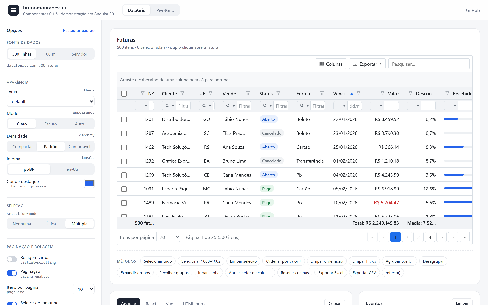
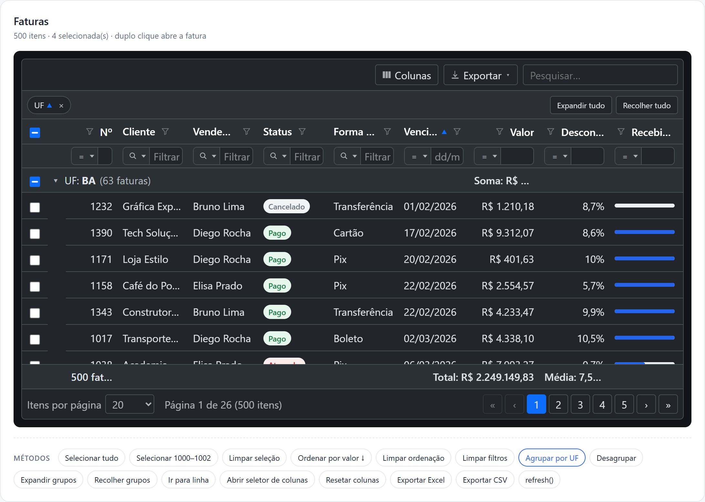
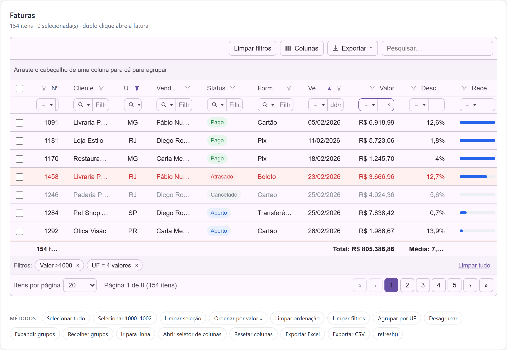
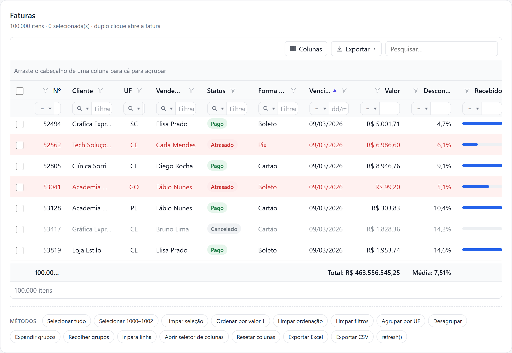
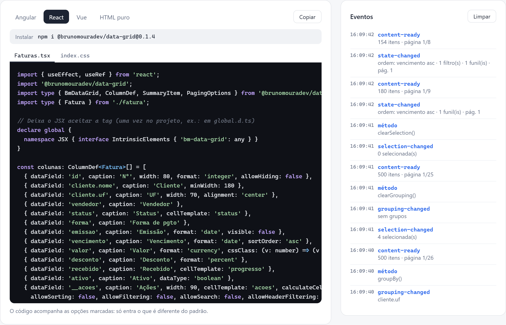

# @brunomouradev/data-grid

> Documentação completa e atualizada (todas as propriedades, métodos e eventos): [DOCUMENTACAO.md](https://github.com/antoniobrunomourateixeira/brunomouradev-ui/blob/main/DOCUMENTACAO.md#4-datagrid)

DataGrid em **Web Component** (`<bm-data-grid>`), no estilo DevExpress. Funciona em Angular (inclusive 11), React, Vue ou HTML puro.

- **Código-fonte:** [github.com/antoniobrunomourateixeira/brunomouradev-ui](https://github.com/antoniobrunomourateixeira/brunomouradev-ui)
- **Exemplo rodando online:** [https://antoniobrunomourateixeira.github.io/brunomouradev-ui-demo/#/datagrid](https://antoniobrunomourateixeira.github.io/brunomouradev-ui-demo/#/datagrid)
- **Exemplo completo (Angular 20, com todas as opções e o código em Angular, React, Vue e HTML puro):** [github.com/antoniobrunomourateixeira/brunomouradev-ui-demo](https://github.com/antoniobrunomourateixeira/brunomouradev-ui-demo)



| Bootstrap 5 escuro, agrupado | Material, filtros e regras de linha |
|---|---|
|  |  |

| 100 mil linhas com rolagem virtual | Código gerado e eventos |
|---|---|
|  |  |

- Ordenação (Shift+clique para ordenar por várias colunas)
- Filter row por coluna (números aceitam `>100`, `<=50`, `<>0`; datas e boolean têm seletor próprio)
- Busca global sem diferenciar acentos nem maiúsculas
- Paginação com seletor de tamanho de página
- Seleção única ou múltipla (checkbox, Ctrl+clique, Shift+clique para intervalo)
- Totais no rodapé: `sum`, `avg`, `min`, `max`, `count`
- Cor/estilo da linha e da célula conforme os dados (`rowClass`, `rowStyle`, `cssClass` com função)
- Rolagem virtual: 100 mil linhas numa rolagem só, desenhando só as visíveis
- Exportação para Excel (.xlsx, sem dependências) e CSV: números e datas como valores, formato da coluna, grupos e totais
- Seletor de colunas: o usuário marca e desmarca as colunas visíveis e arrasta para mudar a ordem
- Reordenar colunas arrastando o cabeçalho (mouse e touch)
- Layout das colunas (ordem e visibilidade) salvável: evento `column-layout-changed` e propriedade `columnLayout`
- Filtro no cabeçalho (funil): lista de valores com busca, quantidade e marcar/desmarcar, como no Excel
- Agrupamento em vários níveis: arraste o cabeçalho para o painel de grupos, expanda/recolha, totais por grupo e seleção do grupo inteiro
- Temas prontos para Bootstrap 4, Bootstrap 5, Tailwind e Material, com claro/escuro e densidade; customização por variáveis CSS
- Build em ES2019 com o Lit embutido: o projeto que usa a grid não precisa instalar mais nada
- Tipos compatíveis com TypeScript 4.1+ (Angular 11)

## Instalação

```bash
npm i @brunomouradev/data-grid
```

Não precisa importar CSS: o visual vem dentro do componente.

## HTML / JS puro

```html
<bm-data-grid id="grid" theme="bootstrap5" key-expr="id" show-filter-row show-search-panel selection-mode="multiple"></bm-data-grid>

<script type="module">
  import '@brunomouradev/data-grid';

  const grid = document.getElementById('grid');
  grid.columns = [
    { dataField: 'id', caption: 'Nº', width: 80 },
    { dataField: 'cliente.nome', caption: 'Cliente' },
    { dataField: 'valor', format: { style: 'currency', currency: 'BRL' } },
    { dataField: 'vencimento', dataType: 'date', sortOrder: 'asc' },
  ];
  grid.dataSource = dados;
  grid.summary = [{ column: 'valor', summaryType: 'sum', displayFormat: 'Total: {0}' }];
  grid.addEventListener('selection-changed', (e) => console.log(e.detail.selectedRowsData));
</script>
```

## Temas: Bootstrap, Tailwind e Material

Escolha o visual do framework que o projeto já usa. Uma linha vale para o sistema todo:

```js
import { configure } from '@brunomouradev/data-grid';

configure({
  theme: 'bootstrap4',   // 'default' | 'bootstrap4' | 'bootstrap5' | 'tailwind' | 'material'
  appearance: 'light',   // 'light' | 'dark' | 'auto' (segue o sistema operacional)
  density: 'standard',   // 'compact' | 'standard' | 'comfortable'
  locale: 'pt-BR',
});
```

Ou por grid, com atributos (valem mais que o `configure`):

```html
<bm-data-grid theme="material" appearance="dark" density="compact"></bm-data-grid>
```

| Tema | Como fica | De onde vêm as cores |
|---|---|---|
| `default` | visual neutro | fixas |
| `bootstrap4` | `.table .table-striped .thead-light` | `--primary` e `--font-family-sans-serif` do Bootstrap 4; o resto é a paleta padrão do BS4 |
| `bootstrap5` | `.table` do Bootstrap 5.3 | `--bs-*` (a grid segue o `$primary` do seu projeto e o `data-bs-theme="dark"`) |
| `tailwind` | tabela do Tailwind UI (cinzas + índigo) | `--color-*`, `--font-sans` e `--radius-lg` do Tailwind 4; defina `--color-primary` para trocar o destaque |
| `material` | tabela do Angular Material 3 | `--mat-sys-*` (segue o tema do Angular Material, inclusive o escuro) |

Se o framework não expõe a variável (Bootstrap 4, Tailwind 3, Material 2), vale a cor padrão dele. Para usar a sua, defina `--bm-color-primary` (veja abaixo).

**Densidade:** `compact` reduz o espaço vertical das células pela metade (parecido com `.table-sm`); `comfortable` aumenta 50%.

## Customizar

Cada parte do visual é uma variável CSS. Elas vencem o tema, então dá para partir do Bootstrap e ajustar só a cor:

```css
bm-data-grid,
bm-pivot-grid {
  --bm-color-primary: #e8590c;     /* destaque: página atual, seleção, foco */
  --bm-header-font-weight: 500;
}
```

| Variável | O que muda |
|---|---|
| `--bm-font-family`, `--bm-font-size` | fonte |
| `--bm-color-text`, `--bm-color-text-muted` | texto e texto secundário |
| `--bm-color-bg`, `--bm-color-bg-alt` | fundo e linhas alternadas |
| `--bm-color-bg-header`, `--bm-color-header-text`, `--bm-header-font-weight` | cabeçalho e rodapé |
| `--bm-color-bg-hover`, `--bm-color-bg-selected` | linha com o mouse e selecionada |
| `--bm-color-border` | bordas |
| `--bm-color-primary`, `--bm-color-primary-text`, `--bm-color-focus` | destaque e contorno de foco |
| `--bm-radius`, `--bm-shadow` | cantos e sombra dos menus |
| `--bm-cell-padding-y`, `--bm-cell-padding-x` | espaço das células |

Para mudar um pedaço específico, use os **CSS parts** (lista em [Customização visual](#customização-visual)):

```css
bm-data-grid::part(header-cell) { text-transform: uppercase; letter-spacing: 0.02em; }
bm-data-grid::part(row-selected) { outline: 1px solid var(--bm-color-primary); }
```

O `themePalette('bootstrap5')` devolve os valores de um tema, útil para montar o seu.

## Angular (11+)

```ts
// app.module.ts
import { CUSTOM_ELEMENTS_SCHEMA, NgModule } from '@angular/core';
import '@brunomouradev/data-grid';

@NgModule({ schemas: [CUSTOM_ELEMENTS_SCHEMA] /* ... */ })
export class AppModule {}
```

```ts
// main.ts: tema e idioma de todas as grids do sistema
import { configure } from '@brunomouradev/data-grid';
configure({ theme: 'bootstrap4', locale: 'pt-BR' });
```

```html
<bm-data-grid
  key-expr="id"
  show-filter-row
  show-search-panel
  selection-mode="multiple"
  [dataSource]="faturas"
  [columns]="colunas"
  [summary]="totais"
  [paging]="{ pageSize: 20 }"
  (selection-changed)="onSelecao($event.detail)"
  (row-dblclick)="abrir($event.detail.data)"
></bm-data-grid>
```

Para chamar métodos: `@ViewChild('grid') grid!: ElementRef<BmDataGrid>` e depois `this.grid.nativeElement.exportToCsv()`.

> Quando você altera o array `dataSource` "por dentro" (push/splice), chame `grid.refresh()`. Atribuir um array novo (`this.faturas = [...]`) atualiza a grid sozinho.

## React

```tsx
import '@brunomouradev/data-grid';

function Faturas({ dados }) {
  const ref = useRef<HTMLElement & { dataSource: any[]; columns: any[] }>(null);
  useEffect(() => {
    ref.current!.columns = colunas;
    ref.current!.dataSource = dados;
  }, [dados]);
  return <bm-data-grid ref={ref} key-expr="id" show-filter-row />;
}
```

## API

### Propriedades

| Propriedade | Atributo | Tipo | Padrão |
|---|---|---|---|
| `dataSource` | — | `T[]` | `[]` |
| `columns` | — | `ColumnDef[]` | geradas a partir da primeira linha |
| `keyExpr` | `key-expr` | `string` | o próprio objeto |
| `paging` | — | `{ enabled, pageSize, pageIndex, allowedPageSizes, showPageSizeSelector, showInfo }` | `{ enabled: true, pageSize: 20 }` |
| `selectionMode` | `selection-mode` | `'none' \| 'single' \| 'multiple'` | `'none'` |
| `showFilterRow` | `show-filter-row` | `boolean` | `false` |
| `showSearchPanel` | `show-search-panel` | `boolean` | `false` |
| `showExportButton` | `show-export-button` | `boolean` | `false` |
| `showRowLines` | `show-row-lines` | `boolean` | `true` |
| `showColumnLines` | `show-column-lines` | `boolean` | `false` |
| `rowAlternationEnabled` | `row-alternation-enabled` | `boolean` | `false` |
| `hoverStateDisabled` | `hover-state-disabled` | `boolean` | `false` |
| `summary` | — | `SummaryItem[]` | `[]` |
| `locale` | `locale` | `string` | `<html lang>` ou o idioma do navegador |
| `messages` | — | `Partial<DataGridMessages>` | pt ou en, conforme o locale |
| `cellStyles` | — | `string` (CSS) | `''` |
| `noDataText` | `no-data-text` | `string` | "Sem dados" |
| `exportFileName` | `export-file-name` | `string` | `'dados'` |
| `exportFormats` | `export-formats` | `('xlsx' \| 'csv')[]` | `['xlsx', 'csv']` |
| `exportSheetName` | `export-sheet-name` | `string` | `'Dados'` |
| `columnChooserEnabled` | `column-chooser-enabled` | `boolean` | `false` |
| `allowColumnReordering` | `allow-column-reordering` | `boolean` | `false` |
| `columnLayout` | — | `ColumnLayoutItem[]` | as colunas padrão de `columns` |
| `theme` | `theme` | `ThemeName` | `configure()` ou `default` |
| `appearance` | `appearance` | `light \| dark \| auto` | `light` |
| `density` | `density` | `compact \| standard \| comfortable` | `standard` |
| `rowClass` | — | `(row, index) => string \| string[]` | — |
| `rowStyle` | — | `(row, index) => { css }` | — |
| `virtualScrolling` | `virtual-scrolling` | `boolean` | `false` |
| `showHeaderFilter` | `show-header-filter` | `boolean` | `false` |
| `showGroupPanel` | `show-group-panel` | `boolean` | `false` |
| `grouping` | — | `GroupDescriptor[]` | o `groupIndex` das colunas |
| `groupSummary` | — | `SummaryItem[]` (+ `alignByColumn`) | `[]` (mostra a quantidade) |
| `autoExpandAll` | `auto-expand-all` | `boolean` | `true` |

### ColumnDef

`dataField` (aceita `"a.b"`), `caption`, `dataType` (`string | number | date | boolean`, inferido se omitido; strings ISO viram `date`), `width`, `minWidth`, `alignment`, `visible` (`false` = coluna opcional, começa escondida e aparece pelo seletor), `visibleIndex`, `allowHiding`, `allowReordering`, `showInColumnChooser`, `groupIndex`, `allowGrouping`, `allowHeaderFiltering`, `filterValues`, `filterType` (`include | exclude`), `allowSorting`, `allowFiltering`, `allowSearch`, `sortOrder`, `sortIndex`, `filterValue`, `selectedFilterOperation`, `format` (opções `Intl` ou uma função), `calculateCellValue`, `cellRender` (retorna texto, um `HTMLElement` ou um template do Lit), `cssClass` (texto ou função `(valor, linha) => classe`).

> O conteúdo de `cellRender` fica dentro do Shadow DOM. Para estilizá-lo, passe o CSS em `cellStyles`.

### Métodos

`refresh()`, `getSelectedRowKeys()`, `getSelectedRowsData()`, `selectRows(keys, preserve?)`, `deselectRows(keys)`, `selectAll()`, `clearSelection()`, `filterColumn(field, text)`, `clearFilter()`, `searchByText(text)`, `sortBy(sorts)`, `clearSorting()`, `goToPage(i)`, `pageIndex()`, `pageCount()`, `totalCount()`, `navigateToRow(key)`, `getVisibleRows()`, `getFilteredRows()`, `getCsv(separator?)`, `exportToCsv(fileName?, options?)`, `getXlsx(options?)`, `exportToExcel(fileName?, options?)` (options: `{ selectedOnly?, sheetName? }`), `getColumnLayout()`, `setColumnLayout(layout)`, `resetColumnLayout()`, `setColumnVisible(field, visible)`, `moveColumn(field, visibleIndex)`, `showColumnChooser()`, `hideColumnChooser()`, `setHeaderFilter(field, values | null, type?)`, `clearHeaderFilter(field?)`, `getHeaderFilters()`, `setHeaderFilters(filters)`, `getHeaderFilterItems(field)`, `groupBy(field, index?, order?)`, `ungroup(field)`, `clearGrouping()`, `getGrouping()`, `expandAll()`, `collapseAll()`.

### Eventos (`CustomEvent`, o payload fica em `event.detail`)

| Evento | detail |
|---|---|
| `row-click` / `row-dblclick` | `{ data, key, rowIndex, originalEvent }` |
| `selection-changed` | `{ selectedRowKeys, selectedRowsData }` |
| `state-changed` | `{ sorts, filters, headerFilters, searchText, pageIndex, pageSize }` |
| `content-ready` | `{ totalCount, pageIndex, pageCount }` |
| `column-layout-changed` | `{ layout }`: `[{ dataField, visible }]` na ordem de exibição |
| `exporting` | `{ format, fileName, selectedOnly }`: antes de baixar. Mude `fileName` ou chame `preventDefault()` para cancelar |
| `grouping-changed` | `{ groups }`: `[{ field, order }]` do primeiro ao último nível |

### Customização visual

- **Temas:** atributos `theme`, `appearance`, `density` ou `configure()` (veja [Temas](#temas-bootstrap-tailwind-e-material))
- **Variáveis CSS:** veja [Customizar](#customizar)
- **CSS parts:** `grid`, `toolbar`, `search`, `header-row`, `header-cell`, `filter-row`, `row`, `row-selected`, `cell`, `summary-row`, `summary-cell`, `pager`, `no-data`, `column-chooser`, `column-chooser-button`, `group-panel`, `group-chip`, `group-row`, `header-filter`, `header-filter-button`, `export-button`, `export-menu`

```css
bm-data-grid::part(header-cell) { text-transform: uppercase; font-size: 12px; }
```

## Colunas padrão, opcionais e layout salvo

```js
grid.columns = [
  { dataField: 'id', caption: 'Nº' },
  { dataField: 'cliente', caption: 'Cliente', allowHiding: false }, // sempre visível
  { dataField: 'valor', caption: 'Valor' },
  { dataField: 'emissao', caption: 'Emissão', visible: false },      // opcional
];
// <bm-data-grid column-chooser-enabled allow-column-reordering>

// Restaura o layout do usuário e salva a cada mudança
grid.columnLayout = JSON.parse(localStorage.getItem('layout-faturas') || 'null') || undefined;
grid.addEventListener('column-layout-changed', (e) =>
  localStorage.setItem('layout-faturas', JSON.stringify(e.detail.layout)));
```

O layout salvo guarda só `dataField` e `visible`. Se você adicionar ou remover colunas no código depois, as que sumiram são ignoradas e as novas entram na posição padrão. A última coluna visível não pode ser escondida.

## Linha e célula conforme os dados

Exemplo: título do tipo 33 com a linha verde.

**Por estilo** (sem CSS):

```ts
grid.rowStyle = (t) => (t.tipo_titulo === 33 ? { background: '#d1f4e0', color: '#116329' } : null);
```

**Por classe**, com o CSS no arquivo de estilos do projeto. O nome devolvido vira um *part* da linha, então o CSS da página alcança a linha mesmo dentro do Shadow DOM:

```ts
grid.rowClass = (t) => {
  if (t.tipo_titulo === 33) return 'titulo-33';
  if (t.status === 'atrasado') return 'atrasado';
  return '';
};
```
```css
/* styles.scss */
bm-data-grid::part(titulo-33) { background: #d1f4e0; color: #116329; }
bm-data-grid::part(atrasado)  { color: #c92a2a; font-weight: 600; }
```

**Só uma célula:** `cssClass` da coluna aceita uma função.

```ts
{ dataField: 'valor', cssClass: (valor) => (valor < 0 ? 'negativo' : '') }
```
```css
bm-data-grid::part(negativo) { color: #c92a2a; }
```

- A linha selecionada e a linha com o mouse por cima continuam com a cor de seleção/destaque, para não perder a referência.
- A cor da regra vence as linhas alternadas.
- Funciona com paginação, agrupamento e rolagem virtual (a função é chamada para cada linha desenhada; mantenha-a simples).
- Use nomes com letras, números, `-` e `_`; outros caracteres são removidos. Evite nomes usados pela grid (`data`, `selected`, `alt`).

No Angular: `[rowClass]="classeLinha"` e `[rowStyle]="estiloLinha"`, com as funções declaradas como propriedades (`classeLinha = (t: Titulo) => ...`), não como métodos, para manter o `this`.

## Rolagem virtual

```html
<bm-data-grid virtual-scrolling style="height: 600px"></bm-data-grid>
```

Sem páginas: todas as linhas ficam numa rolagem só, mas só as que estão perto da área visível são desenhadas (umas 30 por vez). O rodapé mostra "100.000 itens".

- Funciona com filtro, busca, filtro no cabeçalho, ordenação, seleção, totais e agrupamento.
- Ao ordenar, filtrar ou agrupar, a rolagem volta ao topo.
- `navigateToRow(key)` rola até a linha.
- A grid precisa de altura definida.
- A altura das linhas é medida automaticamente, mas precisa ser igual em todas: evite `cellRender` que quebra linha.
- O limite prático é de ~400 mil linhas (o navegador limita a altura de um elemento). Com 100 mil, ordenar leva ~0,3 s e a busca ~1 s no playground.

## Exportar para Excel

```html
<bm-data-grid show-export-button></bm-data-grid>
```

O botão "Exportar" abre um menu com **Excel (.xlsx)**, **CSV** e, quando há linhas selecionadas, **Excel, só as selecionadas**. Com `export-formats="xlsx"` vira um botão único.

O arquivo Excel sai com:

- as linhas filtradas e ordenadas como na tela (todas as páginas) e as colunas visíveis na ordem da tela;
- números e datas como valores de verdade, com o formato da coluna (moeda, porcentagem, casas decimais), então dá para somar e filtrar no Excel;
- cabeçalho em negrito e congelado, autofiltro e largura das colunas ajustada ao conteúdo;
- com agrupamento, as linhas de grupo com os totais e a estrutura de tópicos do Excel (os botões 1/2/+/− recolhem e expandem os grupos);
- os totais do rodapé na última linha.

Colunas com `format` em forma de função saem como texto formatado. O `.xlsx` é gerado no navegador, sem bibliotecas, por `toXlsx()` (também disponível em `@brunomouradev/data-grid/engine`).

```js
grid.addEventListener('exporting', (e) => {
  e.detail.fileName = 'faturas-' + new Date().toISOString().slice(0, 10);
});
grid.exportToExcel();                              // mesmo que o menu
grid.exportToExcel('selecionadas', { selectedOnly: true });
const bytes = grid.getXlsx();                      // Uint8Array, para enviar ao servidor
```

## Filtro no cabeçalho

```html
<bm-data-grid show-header-filter></bm-data-grid>
```

- Cada cabeçalho ganha um funil. Ele abre a lista dos valores da coluna, cada um com a quantidade de linhas, uma busca e "Selecionar todos".
- A lista mostra só os valores das linhas que passam pelos outros filtros (filter row, busca e funis das outras colunas).
- O funil fica azul e preenchido quando a coluna está filtrada. "Limpar filtros" na barra também limpa os funis.
- Texto é comparado sem diferenciar maiúsculas e acentos; datas, pelo dia; vazios aparecem como "(vazio)".
- Quando há menos valores desmarcados que marcados, o filtro é gravado como `exclude`: valores novos que chegarem nos dados continuam aparecendo.
- Clicar no funil não ordena a coluna nem começa a arrastar.

```js
grid.columns = [
  { dataField: 'status', filterValues: ['aberto', 'atrasado'] },              // começa filtrado
  { dataField: 'forma', filterValues: ['Pix'], filterType: 'exclude' },        // tudo menos Pix
  { dataField: 'id', allowHeaderFiltering: false },                            // sem funil
];
grid.setHeaderFilter('cliente.uf', ['PR', 'SC']);
```

## Agrupamento

```html
<bm-data-grid show-group-panel allow-column-reordering></bm-data-grid>
```

- Arraste o cabeçalho de uma coluna para o painel acima da tabela. Arraste outra para criar o segundo nível.
- No painel, clique no grupo para inverter a ordem (▲/▼), arraste para mudar o nível e use o × para desagrupar. Arrastar o grupo de volta para o cabeçalho também desagrupa.
- Clique na linha do grupo para expandir ou recolher. "Expandir tudo" e "Recolher tudo" ficam no painel.
- A coluna agrupada sai da tabela e aparece no título do grupo. A ordenação do usuário continua valendo dentro de cada grupo.
- Texto é agrupado sem diferenciar maiúsculas e acentos; datas, pelo dia.
- A paginação conta as linhas de grupo. Quando um grupo continua na página seguinte, o título dele é repetido com "continuação".
- Com `selection-mode="multiple"`, a caixa da linha do grupo seleciona todas as linhas dele.

```js
grid.columns = [
  { dataField: 'cliente.uf', caption: 'UF', groupIndex: 0 },          // já começa agrupado
  { dataField: 'status', caption: 'Status', groupIndex: 1, sortOrder: 'desc' },
  { dataField: 'valor', caption: 'Valor', format: { style: 'currency', currency: 'BRL' } },
];
grid.groupSummary = [
  { column: 'id', summaryType: 'count', displayFormat: '{0} faturas' },        // ao lado do título
  { column: 'valor', summaryType: 'sum', displayFormat: '{0}', alignByColumn: true }, // na coluna Valor
];

// Salvar e restaurar o agrupamento do usuário
grid.grouping = JSON.parse(localStorage.getItem('grupos-faturas') || 'null') || undefined;
grid.addEventListener('grouping-changed', (e) =>
  localStorage.setItem('grupos-faturas', JSON.stringify(e.detail.groups)));
```

## Motor de dados (sem DOM)

```ts
import { query, resolveColumns, computeSummary, toCsv } from '@brunomouradev/data-grid/engine';
```

É o mesmo pipeline de filtro, busca, ordenação, paginação e totais usado pela grid. Serve para reaproveitar no servidor ou em outros componentes.
