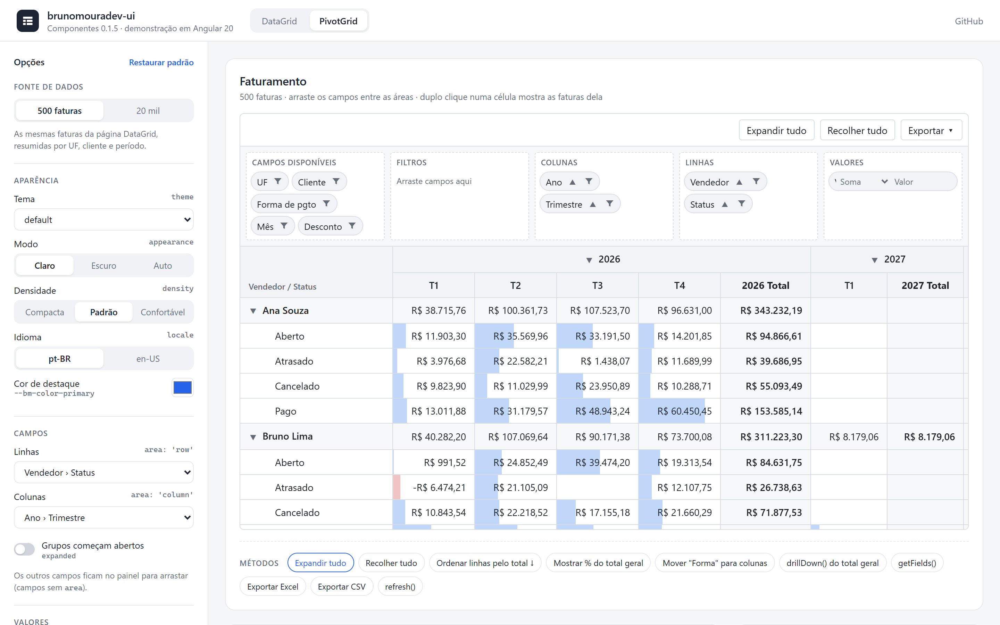
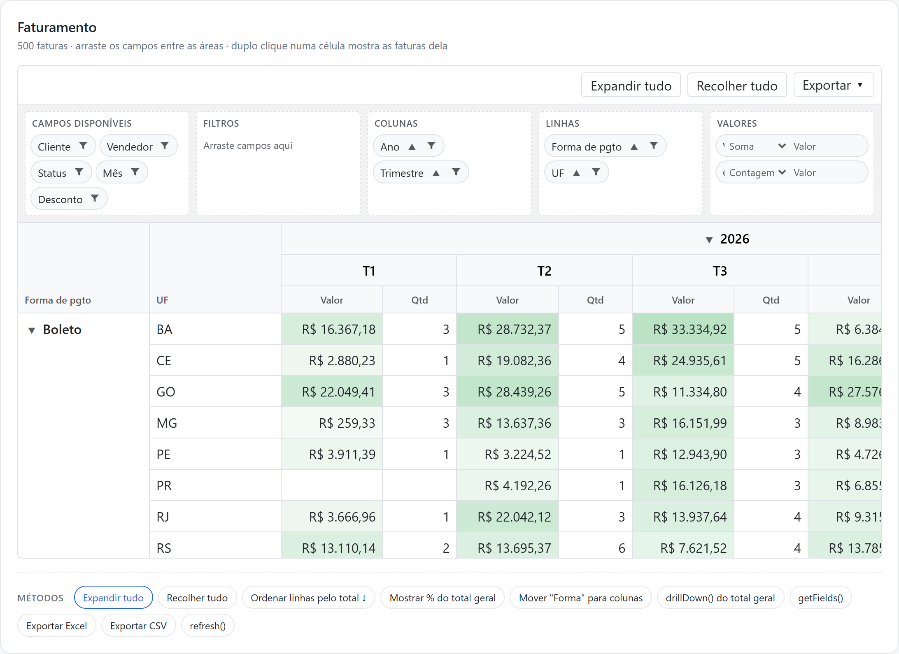
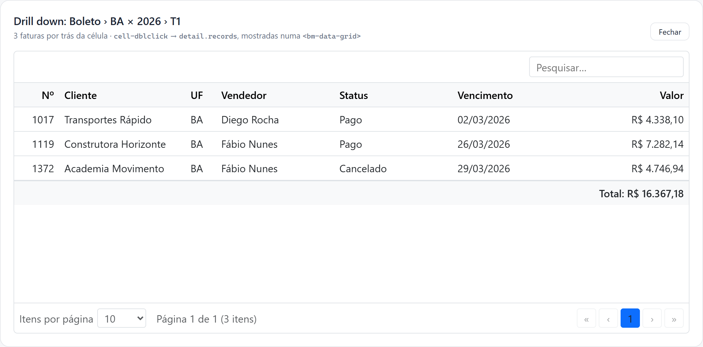

# @brunomouradev/pivot-grid

> Documentação completa e atualizada (todas as propriedades, métodos e eventos): [DOCUMENTACAO.md](https://github.com/antoniobrunomourateixeira/brunomouradev-ui/blob/main/DOCUMENTACAO.md#5-pivotgrid)

Tabela dinâmica (pivot) em **Web Component** (`<bm-pivot-grid>`), no estilo do dxPivotGrid da DevExpress. Funciona em Angular (inclusive 11), React, Vue ou HTML puro.

- **Código-fonte:** [github.com/antoniobrunomourateixeira/brunomouradev-ui](https://github.com/antoniobrunomourateixeira/brunomouradev-ui)
- **Exemplo rodando online:** [https://antoniobrunomourateixeira.github.io/datagrid-prototipo/#/pivot](https://antoniobrunomourateixeira.github.io/datagrid-prototipo/#/pivot)
- **Código do exemplo (Angular 20, todas as opções e o código em Angular, React, Vue e HTML puro):** [github.com/antoniobrunomourateixeira/datagrid-prototipo](https://github.com/antoniobrunomourateixeira/datagrid-prototipo)



| Layout tabular e escala de cores | Drill down numa DataGrid |
|---|---|
|  |  |

- Hierarquias de linhas e colunas com expandir e recolher, inclusive "expandir tudo"
- Subtotais e total geral de linhas e colunas
- Dois layouts de linhas: em árvore (uma coluna com recuo, subtotal na linha do grupo) ou tabular (uma coluna por campo, subtotal numa linha "X Total" abaixo do grupo)
- Vários campos de dados, com `sum`, `avg`, `count`, `min` e `max` (trocáveis pelo painel)
- Agrupamento de datas por `year`, `quarter`, `month`, `day` e `dayOfWeek`
- Filtro por valores com busca, no estilo do header filter
- Painel de campos com arrastar e soltar entre Filtros, Colunas, Linhas e Valores. Funciona com mouse e touch
- Ordenação crescente ou decrescente por campo
- Ordenação por total: clique no cabeçalho de uma coluna (inclusive "Total Geral") para ordenar as linhas pelos valores dela. O clique alterna entre decrescente, crescente e desligado
- Drill down: duplo clique mostra os registros por trás de uma célula
- Exportação CSV do que está visível
- Build em ES2019 com o Lit embutido

## Instalação

```bash
npm i @brunomouradev/pivot-grid @brunomouradev/themes
```

## Uso

```html
<bm-pivot-grid id="pivot" show-field-panel show-export-button show-expand-buttons></bm-pivot-grid>

<script type="module">
  import '@brunomouradev/pivot-grid';

  const pivot = document.getElementById('pivot');
  pivot.fields = [
    { dataField: 'regiao', caption: 'Região', area: 'row', expanded: true },
    { dataField: 'uf', caption: 'UF', area: 'row' },
    { dataField: 'data', caption: 'Ano', groupInterval: 'year', area: 'column' },
    { dataField: 'data', caption: 'Trimestre', groupInterval: 'quarter', area: 'column' },
    { dataField: 'valor', caption: 'Faturamento', area: 'data', summaryType: 'sum',
      format: { style: 'currency', currency: 'BRL' } },
    { dataField: 'categoria', area: 'filter' },
    { dataField: 'vendedor' }, // sem área: fica em "Campos disponíveis"
  ];
  pivot.dataSource = vendas;

  pivot.addEventListener('cell-dblclick', (e) => console.log(e.detail.records));
  pivot.addEventListener('fields-changed', (e) => localStorage.setItem('layout', JSON.stringify(e.detail.fields)));
</script>
```

### Angular (11+)

O uso é igual ao do `@brunomouradev/data-grid`: `CUSTOM_ELEMENTS_SCHEMA` no módulo, `import '@brunomouradev/pivot-grid'` uma vez e bindings de propriedade e evento:

```html
<bm-pivot-grid show-field-panel [fields]="campos" [dataSource]="vendas"
  (cell-dblclick)="abrirDetalhe($event.detail.records)"></bm-pivot-grid>
```

## API

### Propriedades

| Propriedade | Atributo | Padrão |
|---|---|---|
| `dataSource` | — | `[]` |
| `fields` | — | `[]` |
| `showFieldPanel` | `show-field-panel` | `false` |
| `showExportButton` | `show-export-button` | `false` |
| `showExpandButtons` | `show-expand-buttons` | `false` |
| `showRowGrandTotals` / `showColumnGrandTotals` | — | `true` |
| `showColumnTotals` (subtotais de coluna) | — | `true` |
| `allowFieldDragging` / `allowSorting` / `allowFiltering` | — | `true` |
| `rowLayout` | `row-layout` | `'tree'` (ou `'tabular'`) |
| `showRowTotals` (linhas "X Total" no layout tabular) | — | `true` |
| `rowHeaderWidth` (no tabular, largura de cada coluna, até 160) | `row-header-width` | `220` |
| `locale` | `locale` | `<html lang>` ou o idioma do navegador |
| `messages` | — | pt ou en, conforme o locale |
| `exportFileName` | `export-file-name` | `'pivot'` |

### PivotField

`dataField` (aceita `"a.b"`) ou `selector(row)`, `name` (obrigatório quando o mesmo `dataField` aparece mais de uma vez **sem** `groupInterval`), `caption`, `area` (`row | column | data | filter`), `areaIndex`, `dataType`, `groupInterval`, `summaryType`, `format`, `sortOrder`, `sortBySummaryField` (ordena pelo total de um campo de dados, pelo `name` ou `dataField`), `sortBySummaryPath` (caminho no eixo oposto, ex. `[2025]`; padrão `[]` = total geral), `expanded`, `filterValues`, `filterType` (`include | exclude`), `allowSorting`, `allowFiltering`, `allowDragging`.

### Métodos

`refresh()`, `getFields()` (layout atual, para salvar), `moveField(name, area, index?)`, `sortBySummary(dataField, columnPath?, order?)` (ordena as linhas por uma coluna; `null` desliga), `expandAll(area?)`, `collapseAll(area?)`, `drillDown(rowPath, columnPath)`, `getCsv(separator?)`, `exportToCsv(fileName?)`.

### Eventos

| Evento | detail |
|---|---|
| `cell-click` | `{ rowPath, columnPath, rowFields, columnFields, dataField, value, rowType, columnType }`. `rowType` é `value`, `total` (linha "X Total" do tabular) ou `grand` |
| `cell-dblclick` | o mesmo de `cell-click`, mais `records` (drill down) |
| `fields-changed` | `{ fields }`: o usuário mudou área, ordem, filtro, ordenação ou agregação |
| `content-ready` | — |

### Customização visual

As mesmas variáveis CSS do `@brunomouradev/themes`. CSS parts disponíveis: `pivot`, `toolbar`, `field-panel`, `field-zone`, `field-chip`, `scroller`, `column-header`, `row`, `row-header`, `cell`, `no-data`.

## Motor (sem DOM)

`buildCube`, `buildView`, `resolveFields`, `drillDown` e `pivotToCsv` também são exportados. O cálculo roda em duas etapas: `buildCube` faz o trabalho pesado (filtra e agrega todas as combinações uma vez só) e `buildView` monta o layout, que é refeito a cada expandir ou recolher sem reagregar os dados.
